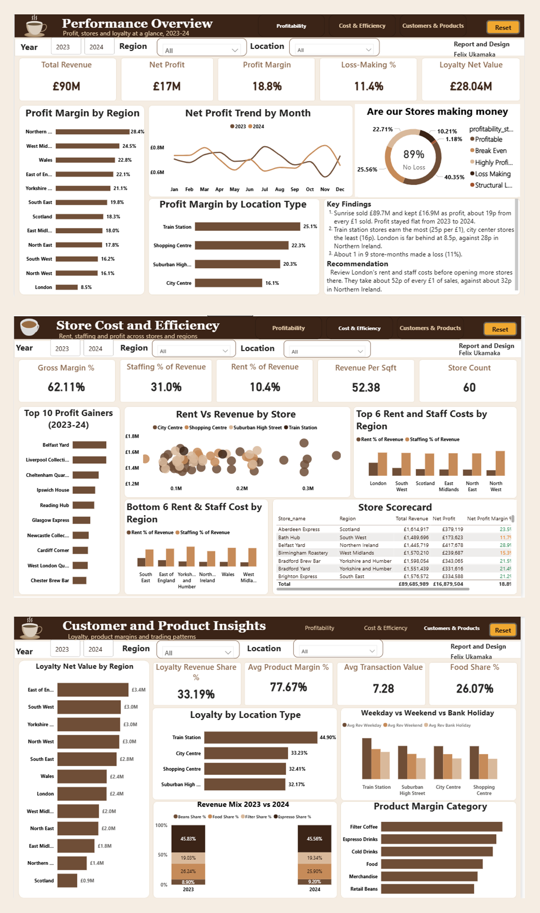
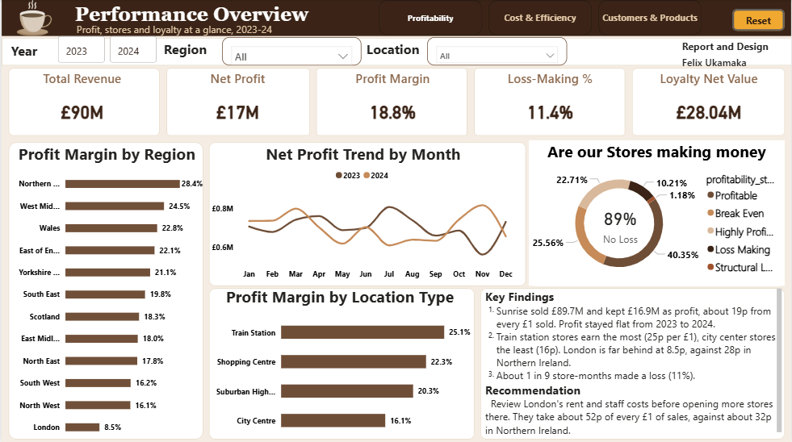
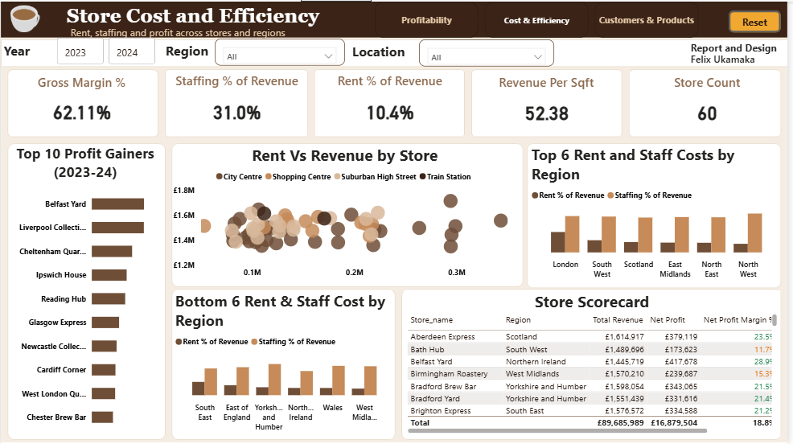
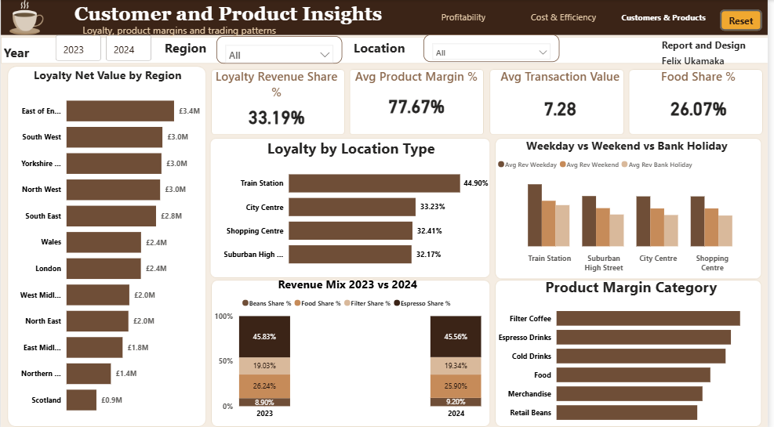

## Sunrise Coffee Chain: 
Where Every £1 Goes
A 3-page Power BI report analysing 60 UK coffee stores across 2023 and 2024. It shows where the business makes money, where profit leaks, and what to do next.
Built for the October 2026 #dataDNA Dataset Challenge by Onyx Data.

 ## Project Overview
Sunrise Coffee Chain operates 60 stores across the UK. The Chief Commercial Officer needs to know:
1. Which locations and regions deliver the strongest and weakest profit
2. Whether the loyalty programme pays for itself
3. How product mix and margins shape revenue
4. When the business trades well and when it doesn't
5. The report answers those questions in three pages, written so a non-technical reader can follow it.

## Key Insights
1. Profitability: £90M revenue and £17M net profit give a net profit margin of 18.8% (about 19p per £1 of revenue), broadly flat from 2023 to 2024.
2. Location performance: Train stations deliver the highest margin (25.1%), followed by shopping centers (22.3%) and suburban high streets (20.3%). City centers are lowest (16.1%).
3. Regional variance: Northern Ireland leads at 28.4%, followed by West Midlands (24.5%) and Wales (22.8%). London trails at 8.5%.
4. Cost structure: Staffing takes 31.0% and rent 10.4% of revenue, against a 62.11% gross margin. In London, rent and staffing take about 52p of every £1 of sales, against about 32p in Northern Ireland.
5. Store health: 89% of store-months are not loss-making. 11.4% fall in the Loss Making or Structural Loss bands.
6. Loyalty: Loyalty customers generate 33.19% of revenue, with a net loyalty value of £28.04M. Train stations show the highest loyalty share (44.90%).
7. Product mix: Espresso holds about 46% of revenue and food about 26%. Beans edged up from 8.90% (2023) to 9.20% (2024). Average product margin is 77.67%, with filter coffee and espresso strongest and retail beans weakest.
8. Seasonality: Weekend and bank holiday revenue run below weekday levels across all location types.

## Recommendations
1. Expansion: prioritise train station and shopping centre sites, and review London's rent and staffing costs before expanding there.
2. Loyalty: retain the programme, given its strong net value and revenue share.
3. Product strategy: focus on the highest-margin categories, filter coffee and espresso.
4. Operations: plan staffing around lower weekend and bank holiday demand.

## Dashboard Pages

Performance Overview: profit margin by region and location type, monthly profit trend, store health, and key findings.
  

Store Cost and Efficiency: gross margin, staffing and rent shares, revenue per sq ft, top profit gainers, rent vs revenue by store, regional cost comparison, and a store scorecard.
  

Customer and Product Insights: loyalty net value by region and location type, revenue mix 2023 vs 2024, product margin by category, and weekday vs weekend vs bank holiday sales.
Every page has Year, Region and Location slicers, page navigation buttons, and a Reset button.

## Tools Used
Power BI Desktop: data model, visuals and interactivity. 
Power Query: data cleaning and transformation. 
DAX: measures and calculated columns. 
PowerPoint: custom page background and layout frame. 

## Data Cleaning (Power Query)
Loaded all five tables and checked column quality and distribution on the entire data set. 
Confirmed no duplicate IDs, and no errors or empty values in key columns. 
Removed unneeded filter and sort steps. 
Standardised text labels (hyphens replaced with spaces in several columns). 
Shortened store names by removing the repeated "Sunrise Coffee" prefix. 
Set correct data types for dates, whole numbers and decimals. 

## Credits
Dataset and challenge: Onyx Data (#dataDNA, October 2026), with SmartFrames UI and Data Career Jumpstart
Dashboard layout inspiration: Frank Agba

## Author
Felix Ukamaka Peace, Data Analyst
LinkedIn: linkedin.com/in/ukamaka-felix-4160993ab
GitHub: github.com/felix-peace
Portfolio: felix-ukamaka-peace.lovable.app
#dataDNA #PowerBI #DataAnalytics
